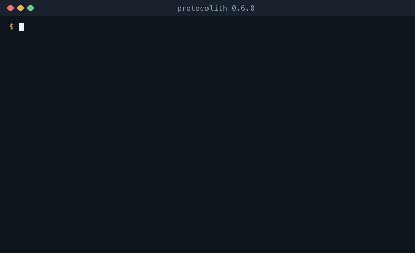

<p align="center">
  <picture>
    <source media="(prefers-color-scheme: dark)" srcset="docs/assets/protocolith/logo-dark.svg">
    
  </picture>
</p>

<p align="center"><b>Records, verifies and issues trial records.</b></p>

<p align="center">
  <a href="https://github.com/protocolith/protocolith/actions/workflows/tests.yml"></a>
  <a href="LICENSE"></a>
  
  <a href="https://doi.org/10.5281/zenodo.24021995"></a>
</p>

<!-- Add these badges only after the packages exist (planned for the 0.6.0 release):
<a href="https://pypi.org/project/protocolith/"></a>
<a href="https://pypi.org/project/protocolith/"></a>
<a href="docs/registry/evidence_index.json"></a>
<a href="https://anaconda.org/conda-forge/protocolith"></a>
-->

<p align="center">
  
</p>

## Why

A result is easy to believe and hard to check when the protocol was written after the run, the history can be
edited silently, or a failed run quietly disappears. Protocolith keeps a small local record that makes those
three things visible: what was fixed beforehand, what happened, and whether the history still adds up.

It does not run experiments, fetch data or judge whether a protocol is a good one. It is a ledger with rules.

## What it does

| Stage | Command | What is stored |
| --- | --- | --- |
| 1. **Freeze** a protocol before the run | `protocolith freeze protocol.json` | The protocol and its SHA-256 |
| 2. **Record** the outcome against that protocol | `protocolith record record.json` | Status, outcome, source hashes, claim boundary |
| 3. **Verify** the hash-chained history | `protocolith verify-ledger` | Nothing; it reports rule violations (R1 to R11) |
| 4. **Issue** a card from a verified record | `protocolith issue SEQ` | A JSON and SVG card, plus an `issue` entry |

Everything lives in one append-only file, `.protocolith/ledger.jsonl`, one canonical JSON line per entry.
Each line contains the hash of the line before it. The core uses only the Python standard library.

## Quickstart (2 minutes)

You need the repository checkout with its environment active (see [Install](#install)). The example files are in
[`examples/quickstart/`](examples/quickstart/): `protocol.json`, `record.json` and the source `results.txt`.

```bash
source .venv/bin/activate          # Windows: .venv\Scripts\activate
mkdir demo && cd demo
cp ../examples/quickstart/protocol.json ../examples/quickstart/record.json ../examples/quickstart/results.txt .
protocolith freeze protocol.json
protocolith record record.json
protocolith verify-ledger
protocolith issue 1
protocolith log
protocolith head
```

Real output of one run (hashes and times differ in yours, because the entries contain the time):

```text
$ protocolith freeze protocol.json
frozen QUICKSTART_D001 1 seq=0 hash=5bbd5c8c75437c20d77415469374ac990993803c1c9deed91ff6adf2f74714b2 protocol_sha256=802a1675aef8623a44d79272ca50c036ffc7c2d2ecd267ca440afdb19948369f
$ protocolith record record.json
recorded run-1 PASSED_UNDER_PROTOCOL seq=1 hash=...
$ protocolith verify-ledger
OK entries=2 head seq=1 hash=...
$ protocolith issue 1
issued record seq=1 card_sha256=...
.protocolith/cards/PLITH-QUICKSTART_D001-<date>-000001.json
.protocolith/cards/PLITH-QUICKSTART_D001-<date>-000001.svg
$ protocolith log
0 freeze <time> 5bbd5c8c7543 QUICKSTART_D001 1
1 record <time> e6fdb7f2c7f6 run-1 PASSED_UNDER_PROTOCOL
2 issue <time> 7e991c8d63f3 record_seq=1
$ protocolith head
seq=2 hash=7e991c8d63f3f661894015c450b41cdb3809af305af4f562f8224466314eecd7
```

The `protocol_sha256` printed by `freeze` is already written into `record.json`; a record that names a hash
that was not frozen earlier is rejected (`UNKNOWN_PROTOCOL`). To see verification fail, change one character in
`.protocolith/ledger.jsonl` and run `protocolith verify-ledger` again: it prints the violated rules and exits with 1.

Exit codes: `0` ok, `1` the stored ledger does not verify, `2` the operation was rejected and nothing was written,
`3` I/O or environment error. `--json` prints canonical JSON for every command. These steps are run by
`tests/test_readme_examples.py`.

## Query the ledger

```bash
protocolith summary                  # what was done and which results are honest, in one call
protocolith log --status BLOCKED_SOURCE
protocolith show 1
```

See [Query the ledger quickly](docs/guides/query-the-ledger.md).

## Python API

```python
from pathlib import Path

from protocolith import core

store = core.Store(".protocolith")
core.freeze(store, core.decode(Path("protocol.json").read_bytes()))
core.record(store, core.decode(Path("record.json").read_bytes()))

verdict = core.verify(store)
print(verdict.ok, verdict.count)          # True 2

result = core.issue(store, 1)
print(result["json_path"])
print(core.head(store))                   # {'count': 3, 'hash': '...', 'seq': 2}
```

Errors are exceptions with a stable `code` (`core.InputError`, `core.EnvError`, `core.VerificationFailed`).
See the [Python API guide](docs/guides/python-api.md).

## Atlas: browse the experiments

`protocolith atlas` builds one self-contained HTML page (inline CSS and JavaScript, no network, works from `file://`)
from the local ledger or a directory of evidence cards: summary tiles, a status chart and monthly timeline, search,
filters, a sortable paged table and a detail drawer with permalinks. Languages other than English come only from
files you supply. See [the atlas guide](docs/guides/atlas.md).

```bash
protocolith atlas --out atlas.html            # the local ledger
protocolith atlas --cards docs/evidence_cards --out site/
```

## MCP client configuration

`protocolith mcp` is a stdio server with eleven tools (`protocolith_summary`, `protocolith_log`, `protocolith_show`,
`protocolith_schema`, `protocolith_capture`, `protocolith_atlas`, `protocolith_freeze`, `protocolith_record`,
`protocolith_deviation`, `protocolith_verify`, `protocolith_issue`) and read-only resources (`protocolith://summary`, `protocolith://ledger`,
`protocolith://schema/<name>`), so an agent can discover the formats itself. It uses no network and writes only
inside the store, apart from the atlas page that `protocolith_atlas` writes inside the working directory. Add it to an MCP client:

```json
{
  "mcpServers": {
    "protocolith": {
      "command": "protocolith",
      "args": ["mcp", "--store", "/path/to/project/.protocolith"]
    }
  }
}
```

See [Use Protocolith from an AI agent](docs/guides/ai-agent-mcp.md) and the [MCP reference](docs/reference/mcp.md).

## Install

From source today (Python 3.11 to 3.15; [uv](https://docs.astral.sh/uv/) recommended):

```bash
git clone https://github.com/protocolith/protocolith.git
cd protocolith
uv sync
uv run protocolith --version      # or: source .venv/bin/activate
```

`pip install protocolith` is available from the 0.6.0 release (planned); it is not published with the ledger commands yet.
The package has no required dependencies.

## Platforms

macOS, Linux and Windows, Python 3.11 to 3.15, headless (no display, no network, no daemon). Appends are
protected by an advisory file lock (`fcntl` on POSIX, `msvcrt` on Windows) and are flushed with `fsync`.

## Commands

| Command | Purpose |
| --- | --- |
| `freeze FILE [--supersedes SHA256]` | Freeze a protocol (a new version supersedes the old one) |
| `record FILE` | Record a run outcome |
| `deviation FILE` | Record a deviation from a frozen protocol |
| `verify-ledger [--expect-head SEQ:HASH]` | Check rules R1 to R11, and optionally an anchored head |
| `issue SEQ [--out DIR]` | Issue the card of a record |
| `summary [--protocol ID]` | Verdict, head, counts and a per-protocol table in one call |
| `log [--protocol ID] [--type T] [--status S] [--tail N]` / `head` | List (filtered) entries / print the last `seq` and `hash` |
| `show SEQ` | One entry with its protocol context |
| `capture [--file PATH ...] [--env]` | JSON fragment with environment and input file hashes for a record `outcome` |
| `schema [NAME]` | JSON Schema of the input bodies and the entry |
| `init` | Create an empty store (safe to repeat) |
| `repair --truncate-partial-tail` | Remove a partial last line left by a crash |
| `mcp` | Run the MCP server on stdio |

All take `--store DIR` (or `PROTOCOLITH_STORE`; default `.protocolith`) and, except `mcp`, `--json`. The alias
`plith` runs the same program. Full list, including the older card commands: [docs/CLI.md](docs/CLI.md).

## Documentation

- Documentation site: <https://protocolith.github.io/protocolith/docs/> (source in [docs/](docs/), map in [docs/docs-map.md](docs/docs-map.md))
- [Getting started](docs/getting-started/first-record.md) and [concepts](docs/concepts/ledger.md)
- [Core specification](docs/spec/CORE_SPEC.md) and [conformance vectors](docs/reference/conformance-vectors.md)
- [Error codes](docs/reference/error-codes.md), [FAQ](docs/FAQ.md), [roadmap](docs/ROADMAP_2026.md), [changelog](CHANGELOG.md)

## What Protocolith does not prove

- **Internal consistency and ordering only.** A valid ledger shows that every entry follows the rules and that
  no entry was changed or reordered without breaking the chain.
- **No wall-clock proof.** Timestamps are written by the machine that appends; the ledger only guarantees they
  never decrease. It does not show that an entry was made at the time it states.
- **No protection against replacing a whole ledger.** Someone who can rewrite the file can write a new, valid
  one, or cut off its end. Publish or anchor the output of `protocolith head` somewhere you do not control
  alone (for example a signed git tag), then check against it with `protocolith verify-ledger --expect-head SEQ:HASH`.
  See [anchoring the head](docs/guides/anchoring-the-head.md).
- It does not show that a protocol is sound, that data is true, or that a result generalises.

## Earlier name and unrelated works

The project was published as ClaimBound Evidence until 0.5.0 and was renamed because unrelated works use a
similar name. It is not a fork of or affiliated with them, and it makes no claim of priority.
See [RELATED_WORK_AND_INDEPENDENCE.md](docs/RELATED_WORK_AND_INDEPENDENCE.md).

## Contributing, security, license

- [CONTRIBUTING.md](CONTRIBUTING.md), [DCO.md](DCO.md), [GOVERNANCE.md](GOVERNANCE.md), [AGENTS.md](AGENTS.md)
- Report vulnerabilities as described in [SECURITY.md](SECURITY.md); do not open a public issue for them. Questions: [SUPPORT.md](SUPPORT.md).
- [Apache-2.0](LICENSE).
