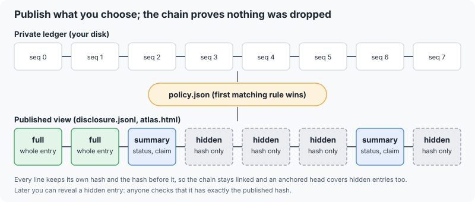
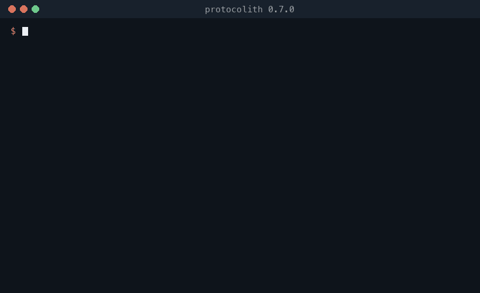
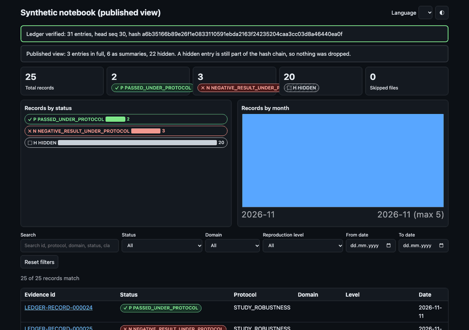

# Publish what you choose: selective disclosure

You may run ten thousand experiments and want to publish a handful. Protocolith keeps **all** of them in one private ledger, and
lets you publish a view in which each entry is shown **in full**, **as a summary**, or **hidden**. The hash chain stays intact, so a
reader sees how many entries exist and that none was dropped, but nothing of what you hid.



## Why this matters

A registry is believable when the unflattering runs are in it. Most research tools show only what the author selected, so a
reader cannot tell a result chosen from ten attempts from one chosen from ten thousand. With a disclosure, the published file
states the total (`entries`), and once its head is anchored (see [anchor your results](anchor-your-results.md)) nobody, including
you, can later remove an entry unnoticed.

## What to publish where

| You want to | Do this | Cost |
| --- | --- | --- |
| keep everything private | keep `.protocolith/` on your disk or in a private repository | nothing |
| prove the history was not edited | `protocolith anchor` and publish the head (one 32-byte hash covers every earlier entry) | one anchor per session, not per experiment |
| show that you tried N things | publish a disclosure in which the exploratory protocols are `hidden` | one file |
| publish a result with its context | make that protocol `full`, the related exploratory ones `summary` or `hidden` | one file |
| let a reviewer check a hidden run later | send them the entry; they run `verify-disclosure --reveal` | one file |
| cite a result for years | release the disclosure and the anchor on GitHub, Zenodo and Software Heritage | a few uploads a year |

Do not upload ten thousand records to a public archive. Anchor the head, publish one disclosure, and archive only what a claim
rests on.

## 1. Write a policy

```json
{
  "v": 1,
  "default": "hidden",
  "rules": [
    {"protocol_id": "PAPER_CLAIM", "level": "full"},
    {"protocol_id": "STUDY_ROBUSTNESS", "level": "summary"},
    {"protocol_id": "SWEEP_*", "level": "hidden"}
  ],
  "summary_fields": ["status", "outcome", "claim_boundary"]
}
```

- A rule has a `level` and **one** selector: `protocol_id` (an exact id, or a prefix ending in `*`), `seq` (a number or a list) or
  `from_seq` with `to_seq`.
- **The first matching rule wins.** An entry no rule matches gets `default`, which is `hidden` when you do not write it:
  nothing is public unless you say so.
- A freeze, a record, a deviation and an issue entry belong to the protocol they refer to, so one rule covers a whole protocol.
- `summary_fields` chooses what a summary shows from a record: `status`, `reproduction_level`, `claim_boundary`, `outcome`,
  `run_id`, `public_claim_text`; a freeze summary shows `question` only if you list it. `protocolith schema policy` prints the schema.

## 2. Publish the view

```bash
protocolith disclose --policy policy.json --out public/disclosure.jsonl
protocolith anchor --write-head public/anchor.txt        # publish the head somewhere you do not control
protocolith atlas --policy policy.json --out public/atlas.html
```

`disclose` refuses a ledger that does not verify. `atlas --policy` builds the same self-contained page as
[the atlas guide](atlas.md), with hidden entries shown as hatched `HIDDEN` rows (their place and hash only) and a banner that
states how many entries are shown in full, as summaries and hidden.





## 3. Let anyone verify it

```bash
protocolith verify-disclosure public/disclosure.jsonl
protocolith verify-disclosure public/disclosure.jsonl --anchors anchors/      # also compare published anchors
```

This checks that the file is canonical, that every line links to the one before, that each full entry hashes to its stated
hash, and that the manifest (count, head) matches. A dropped, reordered or replaced entry is `BAD_DISCLOSURE` or
`DISCLOSURE_CHAIN`; an edited full entry is `DISCLOSURE_HASH`; against an anchor, a rewritten history is `ANCHOR_MISMATCH` and a
cut-off one `ANCHOR_AHEAD`.

## 4. Reveal an entry later

Give the reviewer the one ledger entry (`protocolith show SEQ --json`, or the line from your private ledger). They run

```bash
protocolith verify-disclosure public/disclosure.jsonl --reveal entry.json
# reveal seq=16 level=hidden: MATCHES
```

It matches only when the entry is exactly the one the disclosure committed to; for a summary, the published fields must also
agree with the revealed entry. You can reveal one entry without revealing the others.

## From an AI agent (MCP)

An agent uses `protocolith_disclose` (`policy` as a JSON object, optional `out`) and `protocolith_verify_disclosure` (`file`,
optional `anchors` and `reveal`); `protocolith_atlas` accepts the same `policy`. A sensible instruction for an agent that
works in a private ledger: *"record every run, including failures; before sharing anything, call `protocolith_disclose` with a
policy that publishes only what I name, then `protocolith_anchor`, and tell me the head."*

## Honest limits

- A hidden hash does not reveal the content, but whoever can **guess the whole entry** can confirm the guess. Entries that hold a
  source hash or a precise time are not guessable in practice; a short, predictable body is.
- A **summary is your statement**. It is checked only when the entry is revealed, so publish a summary only of what you can
  reveal.
- Hiding an entry does not hide that it exists, its position, or (for hidden entries) anything else a reader can infer from the
  count. The time of a hidden entry is not published; the time of a summary is.
- A disclosure proves the published entries are consistent with the chain. Whether a result is true is not something a ledger
  decides.
- The ledger is not encrypted. Keep the private ledger private.

Format and rules: [core specification, section 15](../spec/CORE_SPEC.md). A runnable example is in
[`examples/selective_disclosure/`](../../examples/selective_disclosure/).
