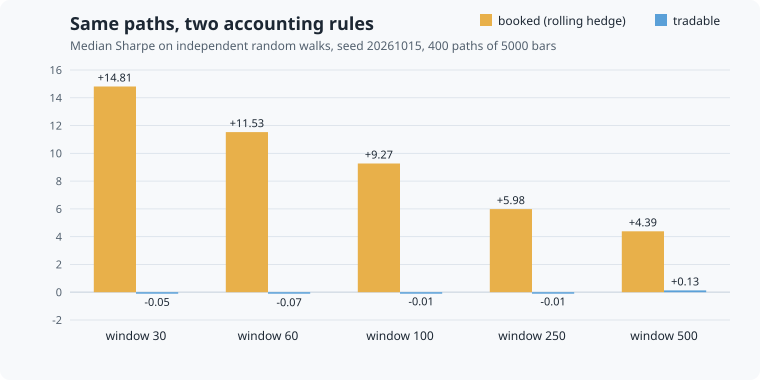

# Example: phantom mean reversion, a retrospective record

A published simulation study kept as a Protocolith record that you can **re-run in about five seconds and compare with the
committed results**. The study: *Phantom Mean Reversion: How Rolling Hedge Ratios Manufacture Profits in Pairs Backtests* (Monte-Neo,
`paper/phantom-mean-reversion`). On two independent random walks, a book that re-estimates its hedge ratio on a rolling window
shows a high Sharpe ratio (4.4 to 14.8 here) although a position that holds the previous hedge earns nothing (median Sharpe
between -0.07 and 0.13). Not investment advice; simulated data only.



Redraw the chart from `results.json` with `python3 scripts/build_phantom_chart.py`.

## Verify it yourself (no trust in the author needed)

```bash
pip install protocolith numpy
python3 reproduce.py                                  # re-runs both simulations; IDENTICAL, EQUAL (within 1e-9) or DIFFERENT
protocolith verify-ledger --anchors --store evidence/.protocolith
protocolith claim-check --seq 1 --store evidence/.protocolith
```

`reproduce.py` runs `code/phantom_mr_sim.py` and `code/other_hedges.py` (seed 20261015) and compares the output with the committed
`results.json` and `results_other.json`. On the author's machine the bytes are identical; on another platform or numpy build the
last bits of some numbers can differ (about 1e-15 on a Linux runner), so the script reports `EQUAL` with the largest relative
difference instead of hiding it, and `DIFFERENT` only if a number moves by more than 1e-9.

## What the ledger contains

| File | What |
| --- | --- |
| `protocol.json` | the question and the gate, frozen first (seq 0) |
| `evidence/anchor-after-freeze.txt` | the head right after the freeze, written before the results were re-computed |
| `evidence/record.json` | the outcome, the sha256 of every source file, the claim boundary, the limits |
| `evidence/.protocolith/ledger.jsonl` | the hash chain: freeze, record, card issue |
| `evidence/.protocolith/cards/` | the evidence card (JSON and SVG) |
| `evidence/anchor-after-record.txt` | the head after the card was issued |

Rebuild everything with `python3 build_ledger.py` (it refuses to overwrite an existing `evidence/`).

## What this record does and does not prove

- It proves the files with these hashes existed when the anchors say, that the chain was not edited afterwards (once the
  anchors are published somewhere you do not control), and that anyone can re-run the code and get the same numbers.
- It is **retrospective**: the study was run and written up before this protocol was frozen. A timestamp proves a record
  existed at time T, not that the analysis was planned earlier. The card says so under known limitations, and the gate was
  written after the numbers were known. `claim-check` therefore lists `independent_reproduction=false`.
- Until the anchor statements are published (release asset, Zenodo, Software Heritage, Wayback or an RFC 3161 time-stamp), the
  ledger is only as strong as the repository that holds it. See `docs/guides/anchor-your-results.md`.
- It says nothing about real markets.

The simulation code is copied unchanged from the Monte-Neo repository (MIT licence); `make_figures.py` needs matplotlib and is
listed in the record only so that its hash is fixed.
