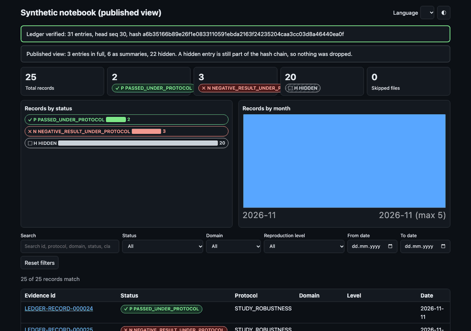

# Example: a private notebook, a public view

A synthetic research notebook of 31 ledger entries (four protocols: two parameter sweeps, a robustness study and a paper claim)
and the view a researcher would publish. The private ledger is **not** in this folder, which is the point; the committed files
are what gets published:

| File | What |
| --- | --- |
| `policy.json` | the choice: `PAPER_CLAIM` in full, `STUDY_ROBUSTNESS` as a summary, every `SWEEP_*` hidden |
| `public/disclosure.jsonl` | the published ledger view (3 entries in full, 6 summaries, 22 hidden) |
| `public/atlas.html` | the self-contained atlas of the published view; open it in a browser |
| `public/anchor.txt` | the anchor statement of the head |
| `public/revealed_entry.json` | one entry the owner chose to reveal (it is hidden in the disclosure) |



## Verify it yourself

```bash
protocolith verify-disclosure public/disclosure.jsonl
protocolith verify-disclosure public/disclosure.jsonl --reveal public/revealed_entry.json
```

The second command prints `reveal seq=16 level=hidden: MATCHES`: the revealed entry is exactly the hidden one the disclosure
committed to. Edit one line of `disclosure.jsonl` and run the first command again to see the failure.

Rebuild everything with `python3 scripts/build_disclosure_demo.py`; the screenshots and GIFs come from
`scripts/build_atlas_screens.py` and `scripts/build_demo_gif.py --scenario disclose`. All data is synthetic.
